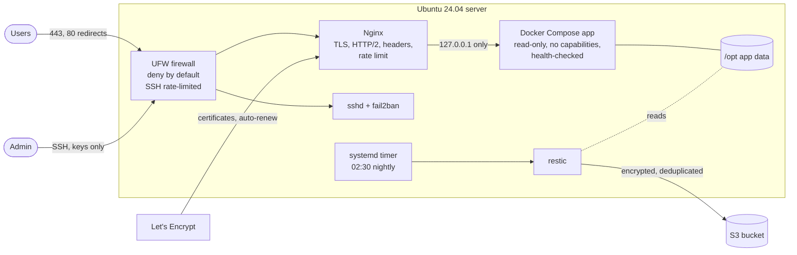

# Production-ready Docker host with Ansible

[](https://github.com/muhammad-31/ansible-docker-host/actions/workflows/ci.yml)


[](LICENSE)

Turns a fresh Ubuntu VPS or EC2 instance into a hardened server running a
Docker Compose application behind Nginx with automatic HTTPS and nightly
encrypted backups. It covers the usual request of "set up my server and deploy
my app properly", without Kubernetes.

Every pull request builds a real server in a container, runs the whole playbook
twice (the second run must change nothing) and checks the result from the inside.

## Architecture



## Roles

| Role | What it does |
|---|---|
| [`base`](roles/base) | Base packages, timezone, chrony time sync, automatic security updates, journald size cap, optional swap file |
| [`hardening`](roles/hardening) | Admin user with SSH keys, key-only SSH (no root, no passwords, `AllowUsers`), UFW deny-by-default with rate-limited SSH, fail2ban (sshd + repeat offenders), kernel network hardening |
| [`docker`](roles/docker) | Docker Engine, Compose and Buildx from Docker's repository (or Ubuntu's packages), log rotation, `live-restore`, `no-new-privileges` |
| [`app`](roles/app) | Deploys a Compose project from variables, secrets in a `0600` `.env`, waits until the app's health endpoint answers |
| [`reverse_proxy`](roles/reverse_proxy) | Nginx with Let's Encrypt (HTTP-01 webroot, auto-renew + reload), HTTP to HTTPS redirect, HTTP/2, HSTS and security headers, per-IP rate limiting, WebSocket support |
| [`backups`](roles/backups) | restic to S3 (or any restic backend) on a systemd timer, optional pre-backup hook for database dumps, retention, and periodic integrity checks |

Each role validates its inputs with `meta/argument_specs.yml`, so a typo or a
missing variable fails with a clear message before anything changes.

## Safety rails built in

- **No lock-outs.** The hardening role refuses to disable password login when no SSH key is configured, and every sshd change is validated with `sshd -t` before it is applied.
- **Docker vs. UFW.** Ports that Docker publishes bypass UFW, a common way servers end up exposing databases. The app role fails if any container port is published on anything but `127.0.0.1`, unless you explicitly allow it.
- **Config changes always apply.** `force_handlers` is on, so a service restart that was triggered is not skipped when a later task fails.
- **Secrets stay out of Git and logs.** Credentials come from Ansible Vault, are written with `0600` permissions and tasks that touch them use `no_log`.

## Quick start

```bash
make setup                                   # Python tooling + Ansible collections
cp -r inventories/example inventories/prod   # then edit hosts.yml and group_vars
ansible-vault encrypt_string --name vault_backups_restic_password 'long-random-password'
make check ENV=prod                          # dry run with diffs
make apply ENV=prod                          # build the server
```

Minimum variables (see [`inventories/example/group_vars`](inventories/example/group_vars/docker_hosts.yml)):

```yaml
hardening_admin_ssh_keys: ["ssh-ed25519 AAAA... you@laptop"]
app_image: ghcr.io/acme/shop:1.4.2
reverse_proxy_sites:
  - name: shop
    server_names: [shop.example.com]
    upstream: http://127.0.0.1:9898
reverse_proxy_letsencrypt_email: ops@example.com
backups_restic_repository: s3:https://s3.amazonaws.com/acme-backups/{{ inventory_hostname }}
backups_restic_password: "{{ vault_backups_restic_password }}"
```

**Release a new version** (only the app role runs):

```bash
make deploy ENV=prod IMAGE=ghcr.io/acme/shop:1.4.3
```

## Restoring from backup

```bash
sudo -i
set -a; . /etc/restic/restic.env; set +a
restic snapshots                                   # pick a snapshot
restic restore latest --target /tmp/restore --include /opt/shop
docker compose -f /opt/shop/compose.yaml down
rsync -a /tmp/restore/opt/shop/ /opt/shop/
docker compose -f /opt/shop/compose.yaml up -d
```

Test a restore after the first backup. A backup that was never restored is not
a backup yet.

## Testing

| Stage | What runs |
|---|---|
| Lint | `yamllint`, `ansible-lint` with the **production** profile, playbook syntax check |
| Converge | the real `playbooks/site.yml` against Ubuntu 24.04 with systemd, in a privileged container |
| Idempotence | the playbook runs a second time and must report zero changes |
| Verify | asserts on the live system: effective `sshd -T` settings, UFW rules, fail2ban jail, Docker daemon settings, container health and localhost-only binding, HTTP to HTTPS redirect, security headers, and a backup that is actually taken and listed |

```bash
make test       # same as CI
make converge   # keep the test server running; `molecule login` to look around
```

## Repository layout

```text
.
├── playbooks/
│   ├── site.yml          # full server build
│   └── deploy.yml        # app release only
├── roles/                # base, hardening, docker, app, reverse_proxy, backups
├── inventories/example/  # copy per environment
├── molecule/default/     # test scenario + verify.yml
├── requirements.yml      # Ansible collections
└── requirements-dev.txt  # pinned lint/test tooling
```

## License

[MIT](LICENSE)
